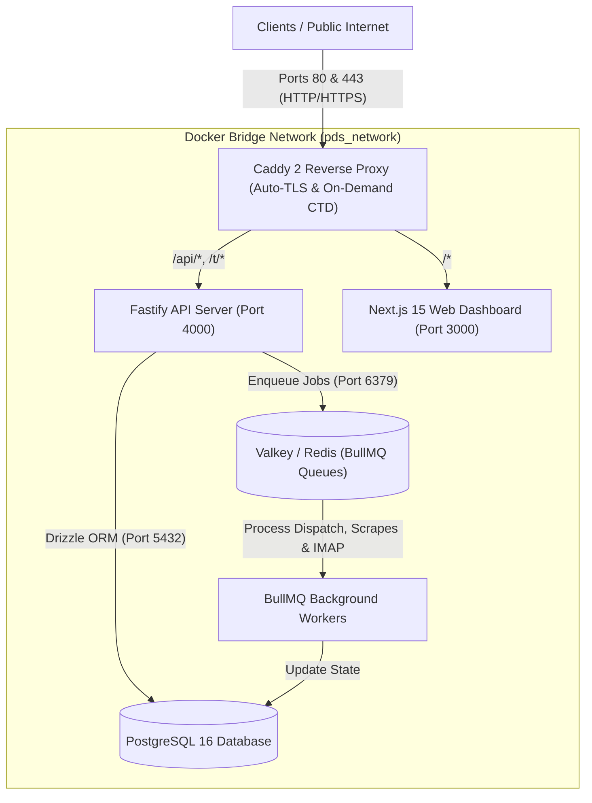

# Predictive Distribution System (DINZIN)

> High-throughput, autonomous outreach, lead enrichment, and adaptive sequence distribution engine. Built with Fastify, Next.js 15, PostgreSQL 16, Valkey (Redis), BullMQ, and Caddy.

[](https://www.typescriptlang.org/)
[](https://fastify.dev/)
[](https://nextjs.org/)
[](https://www.postgresql.org/)
[](https://orm.drizzle.team/)
[](https://www.docker.com/)

---

## Overview

The **DINZIN Predictive Distribution System** is an enterprise-grade distribution and outreach platform designed for high-deliverability sequence dispatch, multi-source lead scraping, and autonomous scheduling.

### Key Capabilities

- **Multi-Tenant Workspaces**: Isolated tenant boundaries with encrypted per-workspace BYOK (Bring Your Own Key) configurations.
- **Autonomous Campaign Engine**:
  - **Tier 0**: Deterministic templating with recursive `{option1|option2}` Spintax parsing.
  - **Tier 1**: Copilot / Human-in-the-loop review.
  - **Tier 2**: Guardrailed autonomous dispatch with dynamic personalization (DeepSeek, OpenAI, Anthropic, Groq).
- **Anti-Spam Deliverability & Jitter**: Randomized delay calculation, active weekday/time sending windows, and daily inbox sending thresholds.
- **Lead Enrichment & Scraping Engine**: Asynchronous lead generation pipeline integrating Google Maps, Apify, and custom crawlers.
- **Super Admin Settings & Dynamic .env Vault**: Zero-downtime credential management in the UI. Super admins can update, live-test, and synchronize `GOOGLE_MAPS_API_KEY`, `APIFY_TOKEN`, AI BYOK keys, and system variables at runtime with AES-256-GCM encryption.
- **Custom Tracking Domains (CTD)**: Caddy On-Demand TLS with automatic Let's Encrypt certificate issuance for open/click tracking endpoints.
- **AES-256-GCM Secret Vault**: Cryptographic encryption at rest for all SMTP credentials, IMAP access tokens, and API secrets.
- **Asynchronous Task Architecture**: Distributed BullMQ workers backed by Valkey (low-memory Redis-compatible key-value store).

---

## System Architecture



---

## Monorepo Layout

```
.
├── apps/
│   ├── api/                 # Fastify backend, API routes, and BullMQ workers
│   └── web/                 # Next.js 15 web UI and dashboard
├── packages/
│   ├── core/                # Shared domain schemas (Zod), crypto, and spintax
│   └── db/                  # Drizzle ORM schema, relations, and migrations
├── deploy/
│   ├── docker-compose.prod.yml # Production multi-container topology
│   ├── Caddyfile            # Caddy reverse proxy and On-Demand TLS rules
│   └── .env.example         # Environment template
├── docs/
│   ├── LLD.md               # Low-Level Design document
│   └── DEPLOYMENT.md        # Comprehensive deployment manual
├── setup.sh                 # One-click server provisioning script
├── deploy.sh                # Zero-downtime deployment and migration script
└── package.json             # Turborepo / npm workspaces root configuration
```

---

## Quick Start (Production Deployment)

This project features a **two-script deployment model** (identical to the DINZIN platform standard).

### 1. Provision Server (Run once on fresh Ubuntu/Debian)
```bash
sudo ./setup.sh
```
*Installs Docker, Docker Compose, sets up a 2GB swap file, configures UFW firewall (22, 80, 443), and establishes Docker log rotation limits.*

### 2. Deploy Application
```bash
./deploy.sh
```
*On first run, it interactively configures your domain, auto-generates AES-256 and JWT secrets, builds containers, runs database migrations, provisions SSL certificates, and schedules nightly database backups.*

---

## Local Development Setup

### Prerequisites
- **Node.js** >= 22.0.0
- **npm** >= 10.0.0
- **Docker** and **Docker Compose**

### Steps

1. **Clone the repository**:
   ```bash
   git clone <REPO_URL>
   cd predictive-distribution-system
   ```

2. **Install dependencies**:
   ```bash
   npm install
   ```

3. **Start local database & cache**:
   ```bash
   docker compose --env-file deploy/.env.example -f deploy/docker-compose.prod.yml up -d postgres valkey
   ```

4. **Run database migrations**:
   ```bash
   npm run --workspace=packages/db migrate
   ```

5. **Start development servers**:
   ```bash
   # Run API & Worker in watch mode
   npm run dev:api

   # In a separate terminal, run Next.js Web App
   npm run dev:web
   ```

The dashboard will be accessible at `http://localhost:3000` and the API at `http://localhost:4000`.

---

## Operations & Maintenance

| Command | Purpose |
| :--- | :--- |
| `./deploy.sh` | Pull latest code, migrate DB, rebuild & rolling update |
| `docker compose -f deploy/docker-compose.prod.yml ps` | Check container health status |
| `docker compose -f deploy/docker-compose.prod.yml logs -f api` | Follow live Fastify API logs |
| `docker compose -f deploy/docker-compose.prod.yml logs -f worker` | Follow BullMQ worker processing logs |
| `docker compose -f deploy/docker-compose.prod.yml logs -f caddy` | Check SSL certificate renewals |

For detailed disaster recovery and rolling rollback procedures, consult [docs/DEPLOYMENT.md](docs/DEPLOYMENT.md).

---

## License

Private & Proprietary — DINZIN. All rights reserved.

