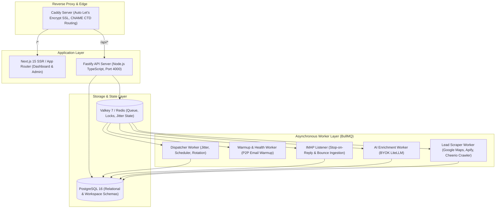
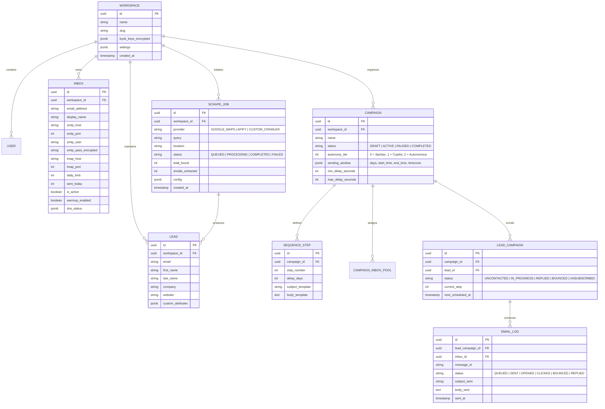
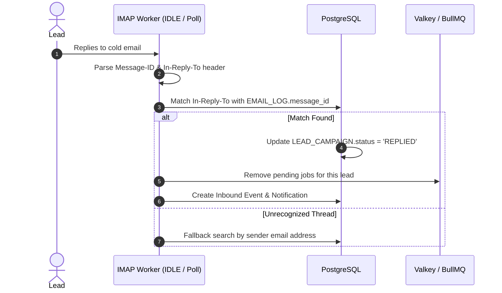
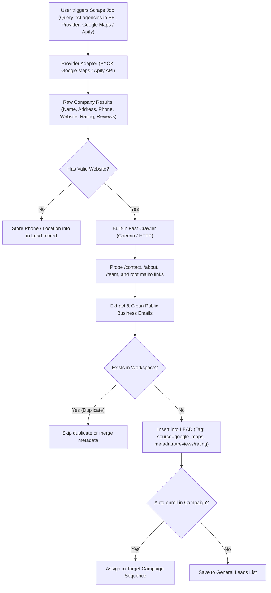

# High-Level Design (HLD) Document
## Project: Predictive Distribution System (v1 Cold Email Engine)

### 1. System Architecture Overview

The system is decoupled into four operational layers running within a cohesive Docker Compose topology optimized for a single low-cost VPS ($10–$15/month):

---

### 2. Relational Data Model (PostgreSQL 16)

---

### 3. Core Engine Mechanics & Algorithms

#### 3.1 Jitter & Sender Pool Distribution Algorithm
1. Every minute, the scheduler queries `LEAD_CAMPAIGN` records where `status = 'IN_PROGRESS'` and `next_scheduled_at <= NOW()`.
2. For each eligible lead, the dispatcher selects an available inbox from the campaign's `CAMPAIGN_INBOX_POOL` where:
   $$\text{sent\_today} < \text{daily\_limit} \quad \text{and} \quad \text{is\_active} = \text{true}$$
3. An atomic distributed lock is acquired in Valkey for that specific inbox to guarantee that no two emails from the same sender are dispatched concurrently.
4. Jitter Delay Calculation:
   $$t_{\text{dispatch}} = \text{NOW}() + \text{random}(\text{min\_delay\_seconds}, \text{max\_delay\_seconds})$$
   (Typical range: 180s to 360s, preventing bursts that trigger spam filters).

#### 3.2 Real-Time Stop-on-Reply Engine

#### 3.3 Configurable Lead Scraping & Enrichment Waterfall

---

### 4. Custom Tracking Domain (CTD) Architecture
* To avoid blacklisting shared tracking domains, users configure a CNAME:
  `track.agencydomain.com -> ctd.yourplatform.com`
* **Caddy** handles on-demand automated TLS for all custom subdomains via HTTP-01 challenge.
* When a recipient opens an email or clicks a masked link, Caddy forwards the request to Fastify:
  - Open tracking: Returns a $1\times 1$ transparent GIF (`Content-Type: image/gif`).
  - Link tracking: Records click event with user-agent and IP, then issues an immediate `302 Redirect` to the destination URL.

---

### 5. Multi-Tenant Security & Isolation
1. **Workspace Data Boundary**: Every SQL query is scoped by `workspace_id`.
2. **Encrypted Vault**: Sensitive keys (BYOK tokens, SMTP/IMAP passwords) are stored encrypted via AES-256-GCM. Decryption keys are held strictly in server memory via environment variables (`MASTER_ENCRYPTION_KEY`).
3. **Tenant Throttling**: Valkey sliding window rate limiter prevents any single tenant from monopolizing the dispatch queue.

---

### 6. Deployment Topology & Resource Footprint

| Service | Technology | Idle RAM Usage | Peak RAM Usage |
| :--- | :--- | :--- | :--- |
| Reverse Proxy | Caddy 2 | ~15 MB | ~30 MB |
| Web UI | Next.js 15 (Node Standalone) | ~70 MB | ~120 MB |
| API Server | Fastify (TypeScript) | ~45 MB | ~90 MB |
| Worker Service | BullMQ Workers | ~55 MB | ~110 MB |
| Database | PostgreSQL 16 Alpine | ~60 MB | ~150 MB |
| Cache & Queue | Valkey 7 / Redis Alpine | ~15 MB | ~35 MB |
| **Total Stack** | **Docker Compose** | **~260 MB** | **~535 MB** |

> **Result**: Runs comfortably on a **$7–$12/month VPS** (e.g., Hetzner 4GB RAM), well within the $20–$25 monthly target budget!
